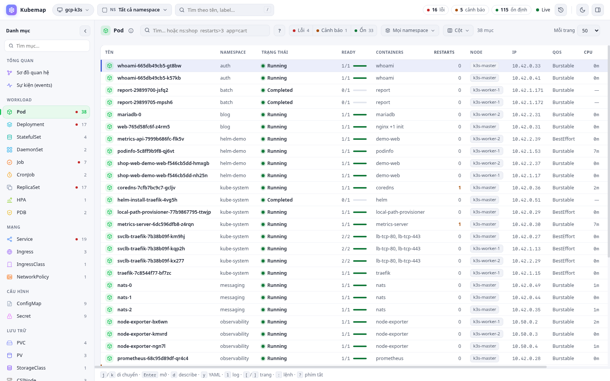
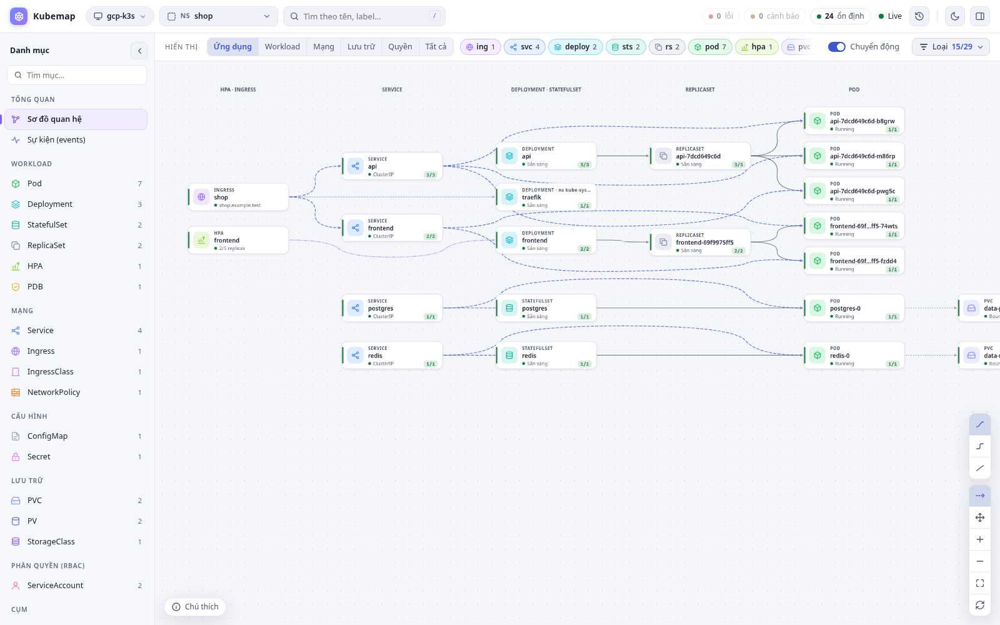
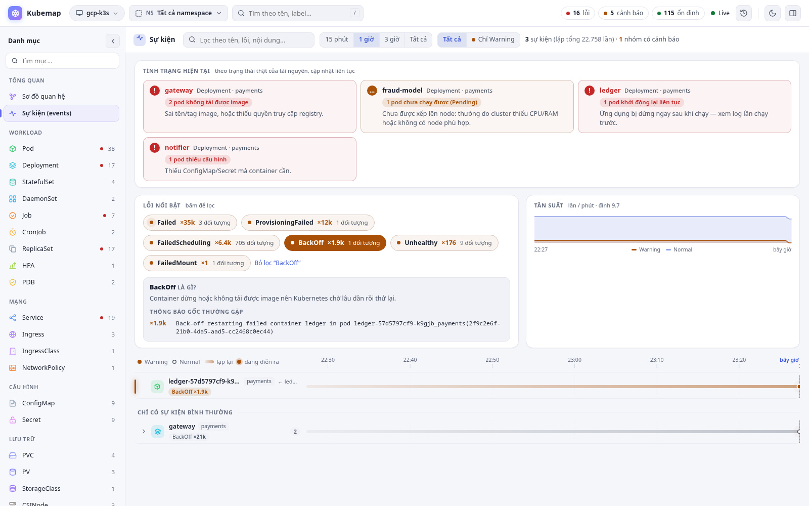
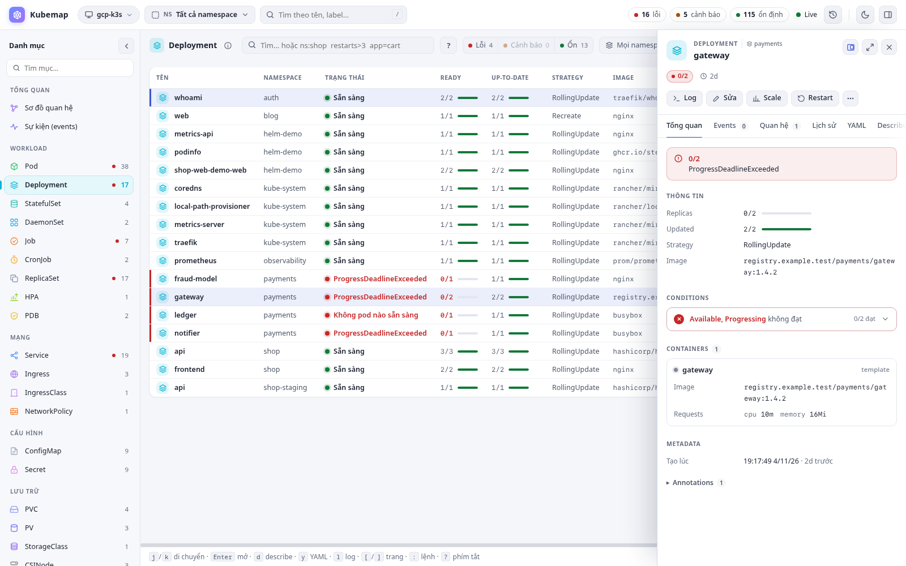
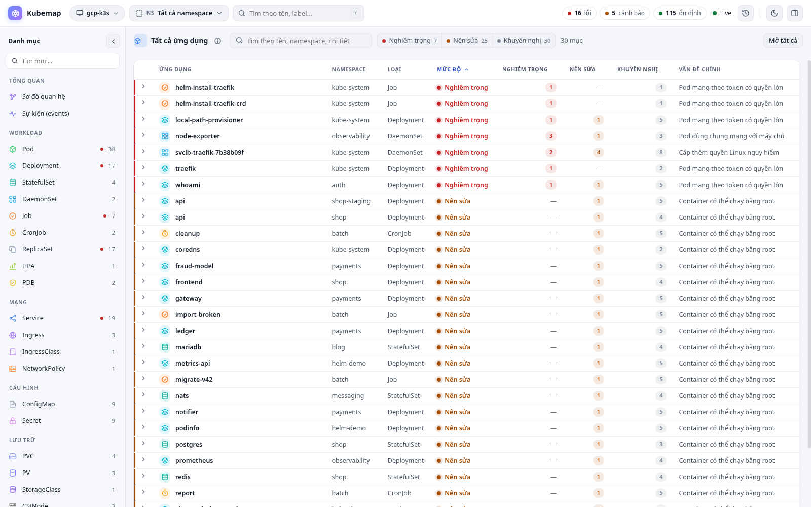
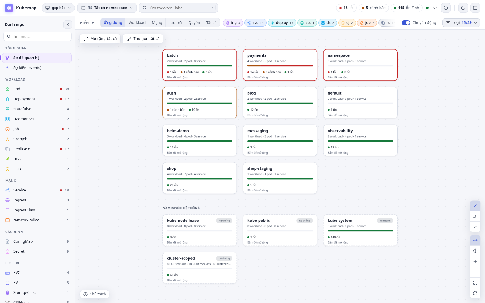
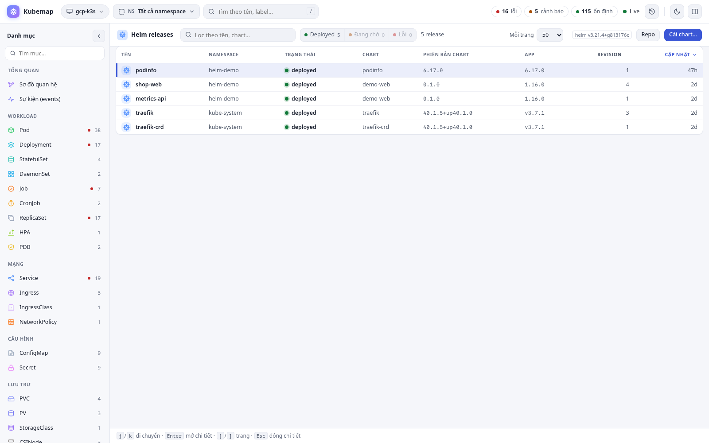
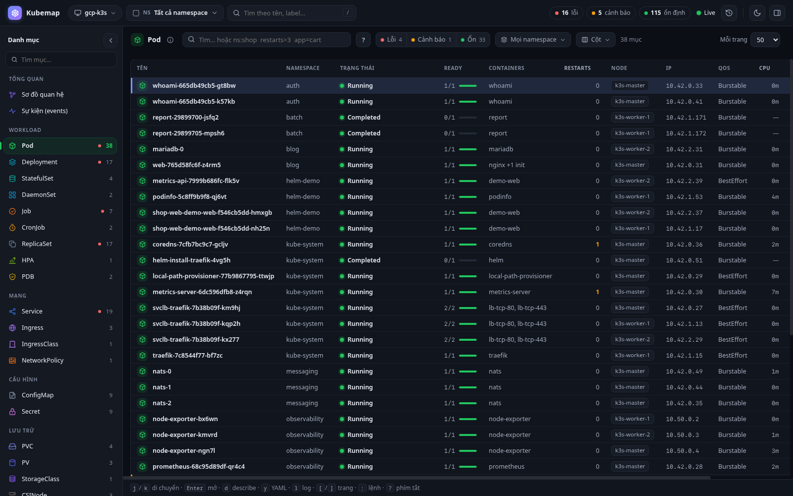
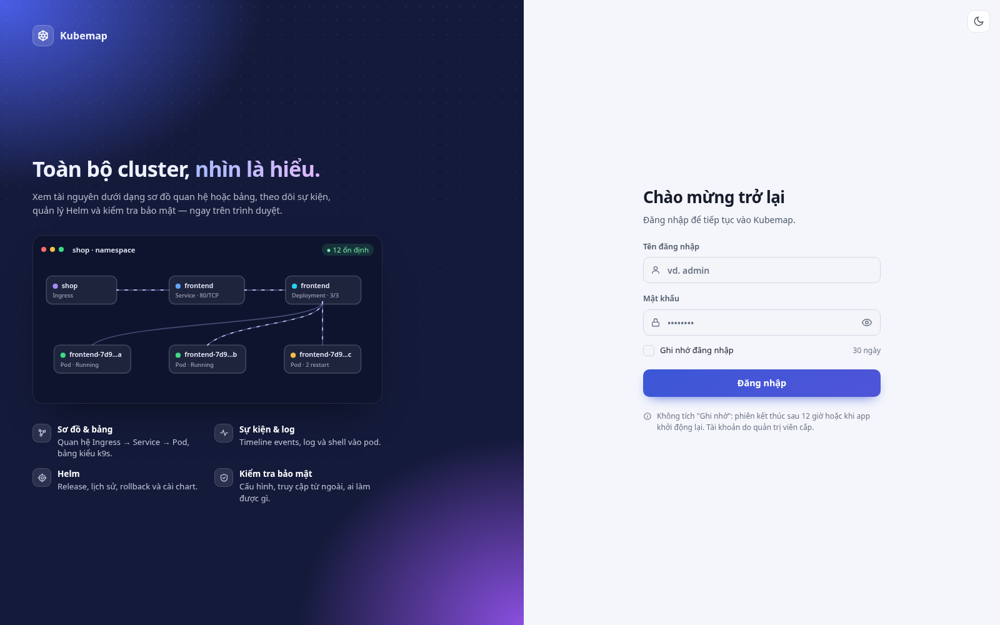

# Kubemap

**Giao diện web để xem và quản lý cluster Kubernetes: nhìn là hiểu cluster đang chạy gì và đang hỏng ở đâu.**

Kubemap là một ứng dụng Spring Boot (Java 25) đọc cluster qua kubeconfig, giữ trạng thái bằng informer (watch) và
hiển thị trên trình duyệt: sơ đồ quan hệ giữa các tài nguyên, bảng kiểu k9s, dòng thời gian sự kiện kèm giải thích
lỗi, Helm, kiểm tra bảo mật, log, shell và port-forward. Giao diện tiếng Việt.



## Tính năng

| | |
|---|---|
| **Bảng tài nguyên** | Mỗi loại một bảng (Pod, Deployment, Service…), cột riêng theo loại, chọn/sắp xếp cột, sắp xếp nhiều cột (Shift + bấm), lọc theo tình trạng và namespace, tìm bằng cú pháp `ns:shop restarts>3 app=cart -kube age<1h`. Lọc, sắp xếp và phân trang chạy **trên server**. Phím tắt kiểu k9s (`j/k`, `Enter`, `d`, `y`, `l`, `s`, `e`, `:po`, `:deploy`…). |
| **Sơ đồ quan hệ** | Ingress → Service → Deployment → ReplicaSet → Pod → Node, PVC, ConfigMap/Secret, HPA, NetworkPolicy, RBAC… Đường traffic chuyển động (tắt được). Toàn cluster gom theo namespace; controller có nhiều pod được gom thành một thẻ “300 pod · 200 Pending · 100 Running”. |
| **Sự kiện** | “Tình trạng hiện tại” đọc từ trạng thái thật của tài nguyên (pod lỗi gom theo ứng dụng, workload thiếu replica, API server chậm). “Lỗi nổi bật” kèm ý nghĩa, thông báo gốc và cách xử lý (ví dụ *Too many pods*, *Insufficient cpu*). Dòng thời gian gom theo đối tượng cha (Deployment, CronJob…). |
| **Chi tiết** | Panel bên phải: tổng quan, Describe (khớp `kubectl describe`), YAML (sửa / so sánh), sự kiện, quan hệ, lịch sử, biểu đồ CPU/RAM. Thao tác: scale, restart, xoá, log, shell vào pod, port-forward. |
| **Helm** | Danh sách release, lịch sử, values, manifest, rollback, gỡ, quản lý repo, cài chart (cần `helm` trên máy chạy Kubemap). |
| **Kiểm tra bảo mật** | Cấu hình ứng dụng (privileged, hostPath, chạy bằng root, thiếu limits, image `:latest`, token ServiceAccount quyền rộng…), điểm truy cập từ ngoài (LoadBalancer, NodePort, Ingress không TLS, hostPort…), “Ai làm được gì” (RBAC, câu hỏi “ai có thể đọc Secret?”). Mỗi mục có giải thích và YAML cách sửa. |
| **Nhiều cluster** | Import kubeconfig ngay trên giao diện (kéo thả hoặc dán), đổi cluster/context lúc đang chạy. Kubeconfig lưu trên máy chạy Kubemap (`config/kubeconfigs/`, quyền 0600), không vào git. |
| **Đăng nhập** | Tuỳ chọn: tài khoản `admin` (toàn quyền) / `viewer` (chỉ xem), “Ghi nhớ đăng nhập” 30 ngày, nhật ký thao tác. |
| **Cluster lớn** | Stream chỉ gửi phần thay đổi (delta), số liệu CPU/RAM gom 15 s, nhịp đẩy giãn theo kích thước; sơ đồ chỉ dựng khi đang xem; gzip + cache. Đã thử với ~1000 pod trên k3s 3 node. |

<table>
<tr><td></td><td></td></tr>
<tr><td align="center">Sơ đồ quan hệ (namespace <code>shop</code>)</td><td align="center">Sự kiện: tình trạng hiện tại, lỗi nổi bật và cách xử lý</td></tr>
<tr><td></td><td></td></tr>
<tr><td align="center">Panel chi tiết của một Deployment</td><td align="center">Kiểm tra bảo mật</td></tr>
<tr><td></td><td></td></tr>
<tr><td align="center">Toàn cluster, gom theo namespace</td><td align="center">Helm releases</td></tr>
<tr><td></td><td></td></tr>
<tr><td align="center">Giao diện tối</td><td align="center">Trang đăng nhập</td></tr>
</table>

## Chạy nhanh

Cần **Java 25** và Maven. `helm` (tuỳ chọn) cho các thao tác Helm; metrics-server trong cluster (tuỳ chọn) cho CPU/RAM.

```bash
mvn -DskipTests package
java -jar target/kubemap-0.1.0-SNAPSHOT.jar
```

Mở <http://localhost:8080>. Lần đầu, bấm tên cluster ở thanh trên → **Import kubeconfig** (hoặc Kubemap tự dùng các
context trong `~/.kube/config` / `$KUBECONFIG`).

Mặc định giao diện chỉ nghe trên `127.0.0.1`, vì nó dùng quyền trong kubeconfig của bạn để thay đổi cluster.

### Đăng nhập

```bash
java -jar target/kubemap-0.1.0-SNAPSHOT.jar hash-password      # nhập mật khẩu → in ra bcrypt hash
```

Đặt tài khoản trong file cấu hình **ngoài git**, ví dụ `config/application.properties` cạnh nơi chạy jar (Spring Boot
tự đọc file này):

```properties
k8s-studio.auth.enabled=true
k8s-studio.auth.users=admin:$2a$10$...:admin,an:$2a$10$...:viewer
```

`admin` được làm mọi thứ; `viewer` chỉ xem (không sửa, không shell, không port-forward, không đổi cluster).

## Cấu hình

Các tuỳ chọn chính (`--tên=giá-trị` khi chạy, hoặc trong file `.properties`). Tiền tố `k8s-studio.` được giữ từ tên
cũ của dự án để không mất cấu hình đã có.

| Tuỳ chọn | Mặc định | Ý nghĩa |
|---|---|---|
| `server.address` / `server.port` | `127.0.0.1` / `8080` | Nơi giao diện lắng nghe |
| `k8s-studio.auth.enabled` | `false` | Bật đăng nhập |
| `k8s-studio.auth.users` | | `tên:bcrypt:role,…` (role: `admin` / `viewer`) |
| `k8s-studio.auth.remember-key` | tự sinh | Khoá ký cookie “Ghi nhớ đăng nhập”; không đặt thì tạo ngẫu nhiên một lần trong `config/secrets/remember-me.key` |
| `k8s-studio.write.enabled` | `true` | `false` = chỉ đọc (ẩn và chặn scale/restart/xoá/sửa) |
| `k8s-studio.kubeconfig-dir` | `config/kubeconfigs` | Nơi lưu kubeconfig import từ giao diện |
| `k8s-studio.include-default-kubeconfig` | `true` | Cho chọn cả các context trong `~/.kube/config` |
| `k8s-studio.system-namespaces` | `^kube-.*,…` | Regex các namespace “hệ thống” (gom lại, xếp cuối) |
| `k8s-studio.helm-binary` | `helm` | Đường dẫn lệnh `helm` |
| `k8s-studio.custom-resources.enabled` | `true` | Đọc cả custom resources (CRD) |
| `k8s-studio.remote.port` | `8091` | Cổng riêng cho port-forward từ xa (`/pf/…`, `/tunnel/…`, mỗi link có token riêng); `0` = tắt |
| `k8s-studio.remote.address` / `remote.public-url` | `127.0.0.1` / | Địa chỉ lắng nghe và địa chỉ công khai của cổng trên |
| `k8s-studio.audit-file` | `~/.k8s-studio/audit.log` | Nhật ký thao tác thay đổi cluster |

## Kiến trúc

```
Kubernetes API ──watch──▶ ClusterCache (informer) ──▶ GraphService ──▶ GraphSnapshots (cache theo namespace)
                                                                          │
              ┌───────────────────────────────────────────────────────────┼──────────────────────────┐
              ▼                                                           ▼                          ▼
   /api/graph/stream (SSE: snapshot rồi delta)      /api/table, /api/table/kinds          /api/events/timeline
   sơ đồ, panel chi tiết, menu                       bảng: lọc / sắp xếp / phân trang      sự kiện: lọc, gom nhóm, phân trang
```

- **Backend:** Spring Boot 3.5, fabric8 kubernetes-client 7.3, Spring Security (đăng nhập tuỳ chọn), WebSocket (shell, tunnel).
- **Frontend:** HTML/CSS/JS thuần (không build step) trong `src/main/resources/static/`, cytoscape.js cho sơ đồ,
  CodeMirror cho YAML, xterm.js cho shell.
- Secret: giá trị không bao giờ được gửi ra giao diện (chỉ tên key).

## Phát triển

```bash
mvn -DskipTests package && java -jar target/kubemap-0.1.0-SNAPSHOT.jar --k8s-studio.auth.enabled=false
```

Công cụ trong [`tools/`](tools/README.md): dữ liệu test 8 namespace (`kubectl apply -f tools/testdata/`), so sánh tab
Describe với `kubectl describe`, chụp màn hình bằng Chrome headless (`node tools/cdp.mjs <url> <out.png> '<js>'`).

## Triển khai lên server

Xem [docs/deploy.md](docs/deploy.md): systemd + Caddy (HTTPS), cập nhật phiên bản và quay lại bản cũ.
